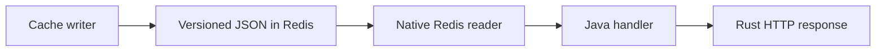

# rest-sample-cache-reader

## Version 0.8.1

This checkout uses REST/platform 4.8.1, cache 0.9.1 and model 0.5.1. It includes
the ARM provenance packaging fix without changing business logic or native ABIs.
Use the aligned 0.8.1 artifacts; earlier 0.8.0 release notes remain historical.
[Patch notes](docs/RELEASE_NOTES_v0.8.1.md).

[English](README.md) | [Türkçe](README.tr.md)

## Start With 0.8.1

The real projection read flow supports optional versioned L1 and owned JSON bodies. Separate profiles demonstrate public edge policies, native views, JWT, tracing, shared slabs and outbound HTTP. The default remains a Redis-only read service.

[Usage guide](docs/functional-operations.md) · [Release notes](docs/RELEASE_NOTES_v0.8.1.md)


Feature, run and error map: [Usage examples](docs/functional-operations.md).

Optional example: [Read a Rust-owned binary buffer and produce JSON](NATIVE_VIEW.md).
The separate `native-view` build does not change the default Redis reader.

Optional example: [Generated outbound HTTP, circuit breakers and native HS256](OUTBOUND.md).
The separate `outbound` build does not connect to Redis.

Optional example: [Public-key JWT and bounded token caching](JWT_SECURITY.md).
The separate `jwt-security` build uses REST/security only; the default Redis reader is unchanged.

Optional example: [Trace a request across HTTP services](TRACE_PROPAGATION.md).
The separate `trace-propagation` build demonstrates W3C parent IDs and retry header preservation.

Optional example: [Return raw Redis JSON through bounded shared native storage](SHARED_SLAB.md).
The separate `shared-slab` build keeps Java handlers. OpenJ9 uses JNI slab; qualified HotSpot can select FFM.
It does not replace versioned projection reads or change the default reader.

A small REST application that reads ready JSON snapshots from Redis.

- HTTP runs on `rust-java-rest`.
- Redis I/O runs in Rust through `java-rust-cache`.
- Java keeps the handler and business flow.
- This application does not connect to PostgreSQL.
- This application does not write to Redis.

Current versions: `rust-java-rest:4.8.1`, `java-rust-cache:0.9.1`, `rust-sample-model:0.5.1`.

## Read This First

Choose this sample when Redis already contains versioned UTF-8 JSON snapshots and the REST service
only reads them. Do not start here for read-through database access, cache writes, or ad-hoc Redis
key composition.

| Goal | Go to |
| --- | --- |
| Run it locally | [Quick Start](#quick-start) |
| Pick standalone, Sentinel, or Cluster | [Choose the Redis mode](#choose-the-redis-mode) |
| Change only application settings | [Configuration](#configuration) |
| Reuse frequently requested JSON in this process | [Optional L1 reads](#optional-l1-reads) |
| Serve an explicitly public product catalog with Rust edge policies | [Public catalog source example](docs/public-edge.md) |
| Enable Glowroot telemetry | [Glowroot Telemetry](#glowroot-telemetry) |
| Diagnose a failure | [Common problems](#common-problems) |

The POM uses `rust-java-platform-parent` and one `rust-java-starter-cache-reader` dependency. The
parent aligns REST, cache, DSL-JSON, codegen, and build-gate versions. Code generators stay on the
compiler path; they are not packaged as runtime classes.

## Current Checkout

This update aligns the platform with REST `4.8.1` and optional agent `0.7.1`.
Use the native file packaged with the dependency you selected. Do not mix older SO/DLL files.
Business code, URLs and configuration keys stay the same. Telemetry remains disabled by default.
The HTTP micro memory gate does not guarantee the same overhead for a database job or a richer profile.

Version `0.8.1` uses platform parent `4.8.1`. Rebuild the application with the aligned
dependencies. See [release notes](docs/RELEASE_NOTES_v0.8.1.md). Runtime settings and URLs are unchanged.

- `@EnableRustCache` creates one managed native cache lifecycle.
- `@GenerateProjectionReader` generates the bound customer read implementation.
- The application starts with `@ReactorApplication`; the handwritten reader module is removed.
- Redis keys, projection namespaces, REST URLs, and read-only behavior are unchanged.
- REST uses the `29/7/6/6` ABI line. The cache package verifies its own Redis ABI `6` contract.

The optional Glowroot micro telemetry plane is available through the aligned REST `4.8.1` runtime.
It is disabled by default. Enable it only when this service must send bounded HTTP and native Redis
timings to an existing Glowroot Central deployment. No handler or projection code changes.

## Declarative Flow

| You write | Generated or managed for you | Not created in this process |
| --- | --- | --- |
| Projection read contract | Bound projection reader | Redis write pool |
| REST handler | Constructor wiring and route invoker | PostgreSQL connection pool |
| Namespace properties | Cache lifecycle and key plan | Scheduler and distributed lock |
| Readiness dependency | Bounded readiness probe | Full object graph for ready JSON |

Copy the application annotation, the projection contract, and the handler. Do not copy manual
`RustCache` construction or Redis key concatenation into business code.

## Start Here

Use this sample when another process already publishes a Redis read model.

A snapshot is a prepared, versioned data set stored in Redis.

```text
PostgreSQL -> cache writer -> Redis -> this reader -> HTTP client
```



If you need to build the snapshots, start with
[`rest-sample-cache-writer`](https://github.com/esasmer-dou/rest-sample-cache-writer).

## Quick Start

### 1. Publish sample data

Follow the writer quick start. It starts the required containers and publishes the customer snapshots.

### 2. Start this reader

Run from this repository:

```powershell
$env:GITHUB_PACKAGES_TOKEN="YOUR_TOKEN_WITH_READ_PACKAGES"

mvn -q `
  "-Dserver.port=18080" `
  "-Dreactor.cache.redis.host=127.0.0.1" `
  "-Dreactor.cache.redis.port=16379" `
  clean compile exec:java
```

The default application class is already configured in `pom.xml`.

### 3. Call the API

```powershell
curl.exe http://127.0.0.1:18080/app/health
curl.exe http://127.0.0.1:18080/app/readiness
curl.exe http://127.0.0.1:18080/api/v1/cache/customers/1
curl.exe "http://127.0.0.1:18080/api/v1/cache/customers/by-customer-no?customerNo=CUST-1002"
curl.exe http://127.0.0.1:18080/api/v1/cache/customers/segments/pilot
curl.exe http://127.0.0.1:18080/api/v1/cache/customers/statuses/active
curl.exe http://127.0.0.1:18080/api/v1/cache/customers/campaigns/retention/candidates
curl.exe http://127.0.0.1:18080/api/v1/cache/customers/meta
```

`/app/health` only checks the process. `/app/readiness` also checks whether the Redis snapshot exists.

## Main Endpoints

| Endpoint | Returns |
|---|---|
| `GET /api/v1/cache/customers/{id}` | One customer snapshot |
| `GET /api/v1/cache/customers/by-customer-no?customerNo=...` | One customer by business number |
| `GET /api/v1/cache/customers/segments/{segment}` | Customers in a segment |
| `GET /api/v1/cache/customers/statuses/{status}` | Customers with a status |
| `GET /api/v1/cache/customers/campaigns/{campaign}/candidates` | Campaign candidates |
| `GET /api/v1/cache/customers/meta` | Snapshot metadata |
| `GET /api/v1/cache/customers/cache-metrics` | Cache metrics as JSON |

## Choose the Redis Mode

| Environment | Set |
|---|---|
| Local Redis | `reactor.cache.redis.topology=standalone` |
| Redis Sentinel | `reactor.cache.redis.topology=sentinel` plus Sentinel nodes and master name |
| Redis Cluster | `reactor.cache.redis.topology=cluster` plus cluster nodes |

The reader is intentionally read-only:

```properties
reactor.cache.redis.access-mode=read-only
```

Do not enable write capacity in this process unless the application also owns a write use case.

## Configuration

The application reads configuration in this order:

1. `src/main/resources/rust-spring.properties`
2. Files passed through `reactor.config.file` or `REACTOR_CONFIG_FILE`
3. JVM `-D...` values and supported environment variables

Use the local defaults first:

```properties
server.port=8080
reactor.runtime.profile=micro-rest
sample.cache.customer.namespace=crm.customer
reactor.cache.redis.host=127.0.0.1
reactor.cache.redis.port=6379
```

Use the production overlay in a deployment:

```powershell
java "-Dreactor.config.file=src/main/resources/config/production.properties" ...
```

Use advanced tuning only after measuring latency, rejected requests, and process memory (RSS):

```powershell
java "-Dreactor.config.file=src/main/resources/config/production.properties;src/main/resources/config/advanced-tuning.properties" ...
```

| File | Purpose |
|---|---|
| `rust-spring.properties` | Small local defaults |
| `config/production.properties` | Safe production limits and timeouts |
| `config/advanced-tuning.properties` | Route limits, native trim, and namespace overrides |
| `config/l1.properties` | Optional bounded detail/segment L1 storage; disabled in the base configuration |

Reader and writer namespaces must match. If the writer publishes `crm.customer.campaign`, the reader must use the same campaign namespace.

## Optional L1 Reads

Sample `0.8.0` uses the released cache `0.9.0` L1 reader with REST/platform `4.8.0`.
Use the aligned published dependencies and their packaged native library; sibling
library source builds are not a prerequisite. L1 remains opt-in.

Use L1 when the same customer or segment is requested often. Redis remains the source
of the versioned snapshot. A hit avoids fetching the JSON from Redis again. Java
handlers, validation and response codes do not change. This is not a Rust edge bypass.

The sample contract allows L1 selection at build time:

```java
@GenerateProjectionReader(
    rootPrefix = "sample.cache.customer",
    generatedName = "CustomerCacheReader",
    restBean = true,
    allowL1 = true)
public interface CustomerCacheService {
    @ProjectionIdRead(projection = "detail")
    CacheReadValue customerValue(long id);
}
```

The actual ID and segment handlers use `CacheReadValue`: `CacheResponses.valueJson(...)`
by default, or `CacheResponses.valueProblem(...)` when `sample.errors.common-contract=true`.
With L1 disabled, this forwards the Redis byte array as a raw response. No snapshot
wrapper is created. With L1 enabled, the value carries an owned snapshot.
The response writer releases its pin after writing or cancellation. Do not close it
after handing it to the response helper. Existing result/snapshot APIs still work.

The normal startup still uses Redis-only readers. To enable L1 for detail and segment:

```powershell
mvn -q `
  "-Dreactor.config.file=src/main/resources/config/l1.properties" `
  "-Dreactor.cache.redis.host=127.0.0.1" `
  "-Dreactor.cache.redis.port=16379" `
  compile exec:java
```

| Setting in this overlay | Effect |
| --- | --- |
| `sample.cache.customer.detail.l1.max-entries=16` | Keeps up to 16 detail entries in a fixed slab. |
| `sample.cache.customer.detail.l1.max-entry-bytes=2048` | Caches detail payloads up to 2 KiB locally. |
| `sample.cache.customer.segment.l1.max-entries=4` | Keeps up to four segment entries. |
| `sample.cache.customer.segment.l1.max-entry-bytes=32768` | Caches segment payloads up to 32 KiB locally. |
| `sample.cache.customer.detail.l1.max-bytes=65536` | Caps detail slab plus estimated metadata. |
| `sample.cache.customer.segment.l1.max-bytes=163840` | Caps segment slab plus estimated metadata. |
| `sample.cache.customer.detail.l1.max-age-ms=1000` | Refetches an expired detail entry. Segment uses the same 1000 ms age. |
| `sample.cache.customer.segment.l1.max-age-ms=1000` | Refetches an expired segment entry. |
| `sample.cache.customer.detail.l1.max-key-chars=256` | Limits the stored detail/index key to 256 UTF-16 units. |
| `sample.cache.customer.segment.l1.max-key-chars=256` | Applies the same key bound to segment entries. |
| `sample.cache.customer.l1.max-entries=0` | Leaves projections disabled unless they have their own enabled setting. A JVM/global runtime override of 0 disables all of them. |
| `sample.cache.customer.version-cache-ms=1000` | Checks the snapshot version at most once per second in sequential reads. Concurrent expired readers may each check it. |

The two slabs total about 0.17 MiB per process/replica. This is storage, not the application's total RSS.
Status, campaign and metadata remain Redis-only. Payloads above the entry limit bypass
L1; they do not become errors.

These limits size the cache, not the HTTP response. If your customer JSON regularly
exceeds 2 KiB, increase both `sample.cache.customer.detail.l1.max-entry-bytes` and
`sample.cache.customer.detail.l1.max-bytes`. For example, `8192` and `196608` allow
16 entries of up to 8 KiB. For larger segment lists, use
`sample.cache.customer.segment.l1.max-entry-bytes=131072` together with
`sample.cache.customer.segment.l1.max-bytes=655360`. This reserves more local memory.
Keep the smaller recipe when larger replies are rare; they still return through Redis.

On an L1 hit, the `CacheReadValue` response transfers an owned native handle through
the REST response writer. Bytes are copied from the slab to the native HTTP buffer
without a Java payload array. The Java handler is still called. This is not zero-copy networking.
Rust owns the large native frame until sending ends. Returning it to the pool does not
guarantee that its pages immediately return to the operating system.
The original `CacheReadResult` getters still return independent byte arrays.

With L1 disabled, the current value route returns the Redis `byte[]` as a raw body,
without a snapshot wrapper. Explicit `customerSnapshot(...)` / `segmentSnapshot(...)`
calls are a separate ownership API and still create small ownership objects in Redis-only mode.
L1 trades local memory for fewer Redis reads. It is not a guaranteed RSS reduction.
Keep the normal Redis-only configuration when minimum memory matters most.

| Your use case | Choose |
| --- | --- |
| Return prepared JSON through the current HTTP routes | `CacheReadValue` and `valueJson(...)` / `valueProblem(...)` |
| Explicitly own a snapshot in custom code | `CacheReadSnapshot` and `CacheResponses.ownedJson(...)` |
| Inspect or modify JSON bytes in Java | The existing `CacheReadResult` getters |

Alternative explicit-ownership example inside your own controller (not the current handler implementation):

```java
@GetMapping("/{id}")
public ResponseEntity<?> customer(@PathVariable("id") long id) {
    return CacheResponses.ownedJson(
        customerCache.customerSnapshot(id),
        "customer_not_cached", "customer_cache_not_ready");
}
```

The helper takes ownership. The writer releases it after writing, on error, or when
a retained native buffer retry is aborted. A too-small buffer keeps the same snapshot
for retry; the Java handler does not run again. Do not reuse one snapshot for another
HTTP request. Close it yourself if you obtain it but decide not to return it.
Do not put a snapshot returned through `ownedJson(...)` in a controller-level
try-with-resources block: that would close it before the framework writes the response.
The same URI, UTF-8 content and error contract are preserved. A matching REST runtime
is required; an older native runtime without buffered-result retry fails closed on
owned-body overflow rather than replaying business logic.

L1 age is not Redis TTL. A newly published snapshot becomes visible after the configured
version-check interval. Use `version-cache-ms=0` if every read must check the version;
that still allows L1 payload reuse, but requires a Redis version read on every call.
Source failures are not silently converted into stale responses. Do not choose L1 for
data that cannot tolerate the selected version-check interval.
Keep the L1 age shorter than the snapshot TTL. L1 does not check Redis key expiry on
every hit. If deletion/expiry must be reflected on every read, keep that projection Redis-only.

To disable L1 while keeping the overlay, add
`-Dsample.cache.customer.l1.max-entries=0`, or set
`SAMPLE_CACHE_CUSTOMER_L1_MAX_ENTRIES=0`. To check that L1 is actually used:

```powershell
curl.exe http://127.0.0.1:8080/api/v1/cache/customers/cache-metrics
```

The new `l1` object reports `enabled_projections`, `hits`, `misses`, `slab_bytes`
and `active_borrows`. After requests have drained, `active_borrows` should be zero.
Closing the managed generated reader drops its L1 storage ownership. The Redis client
has its own lifecycle. See the [L1 contract](https://github.com/esasmer-dou/java-rust-cache/blob/master/docs/versioned-l1.md)
for freshness, lease and memory limits.

## Glowroot Telemetry

This application runs on Rust-Java REST. It does not need a Spring starter or a separate agent
runtime dependency. Telemetry is disabled by default. When enabled, HTTP routes and native Redis
read timings are collected inside the same Rust runtime. Handler and projection code do not change.

This sample already uses the platform `4.8.1` with Glowroot ABI `6`. The optional
`java-rust-glowroot-agent:0.7.1` JAR is needed only when you want `-javaagent` syntax; the embedded
REST telemetry runtime does not require a separate agent dependency:

```xml
<parent>
  <groupId>com.reactor</groupId>
  <artifactId>rust-java-platform-parent</artifactId>
  <version>4.8.1</version>
  <relativePath/>
</parent>
```

Add these values to `rust-spring.properties` for local use:

```properties
reactor.glowroot.enabled=true
reactor.glowroot.profile=micro
reactor.glowroot.collector.address=http://127.0.0.1:8181
reactor.glowroot.agent.id=cache-reader-local
reactor.glowroot.application.name=rest-sample-cache-reader
reactor.glowroot.http.sample-rate=256
reactor.glowroot.trace.capacity=0
```

If you explicitly set `reactor.native.capabilities`, include every required surface:

```properties
reactor.native.capabilities=http,redis,glowroot
```

Supply the same settings through environment variables in Kubernetes:

```yaml
env:
  - name: REACTOR_GLOWROOT_ENABLED
    value: "true"
  - name: REACTOR_GLOWROOT_PROFILE
    value: "micro"
  - name: REACTOR_GLOWROOT_COLLECTOR_ADDRESS
    value: "http://glowroot-collector.observability.svc.cluster.local:8181"
  - name: REACTOR_GLOWROOT_AGENT_ID
    valueFrom:
      fieldRef:
        fieldPath: metadata.name
  - name: REACTOR_GLOWROOT_APPLICATION_NAME
    value: "rest-sample-cache-reader"
```

Check the local agent state after startup:

```powershell
curl.exe http://127.0.0.1:18080/diagnostics/glowroot
```

| Need | Profile | Use |
|---|---|---|
| Normal production traffic | `micro` | HTTP, Redis, RSS, thread, and exporter health |
| Heap or GC investigation | `jvm` | Enable temporarily on one pod |
| SQL timing | Do not use | This reader does not connect to PostgreSQL |
| Error and JVM investigation | `full` | Use for a short incident window |
| Thread or heap output | `diagnostic` | Use only for an authorized operation |

The `micro` production gate allows at most one exporter thread and a `3 MiB` resident-memory
boundary. A collector outage does not stop reader traffic. Unsent telemetry is reflected in bounded
drop counters. Do not expose `/diagnostics/glowroot` through a public ingress.

Keep the default when telemetry is not required:

```properties
reactor.glowroot.enabled=false
```

See the
[`java-rust-glowroot-agent`](https://github.com/esasmer-dou/java-rust-glowroot-agent/blob/master/README.md)
guide for runtime profile switching and the complete property reference.

## Code Map

| File | Why it matters |
|---|---|
| `RestSampleCacheReaderApplication.java` | Enables generated REST and Rust cache lifecycle |
| `CacheReaderConfiguration.java` | Declares only the readiness endpoint bean |
| `CustomerCacheService.java` | Declares projection reads; its implementation is generated |
| `CustomerCacheHandler.java` | Exposes REST endpoints |
| `rust-spring.properties` | Local settings |

ID and segment routes use `CacheReadValue`; other cache routes use `CacheReadResult`
and raw JSON responses. Neither rebuilds a large Java object tree. See the L1 section
for the Redis-only byte-array path versus owned native response handling.

The application does not create `RustCache`, bound projections, or handlers by hand. `@EnableRustCache`
owns native cache startup/shutdown. `@GenerateProjectionReader` binds projection and index names once
at startup. `@ReactorApplication` and constructor injection connect the generated reader to the REST
handler. These helpers are build-time generated and do not add request-time reflection.

## Maven Package Access

GitHub Packages requires a token with `read:packages`. The token also needs access to the private shared sample repositories.

Add these server IDs to `~/.m2/settings.xml`:

```xml
<servers>
  <server>
    <id>github-rust-java-rest</id>
    <username>YOUR_GITHUB_USERNAME</username>
    <password>${env.GITHUB_PACKAGES_TOKEN}</password>
  </server>
  <server>
    <id>github</id>
    <username>YOUR_GITHUB_USERNAME</username>
    <password>${env.GITHUB_PACKAGES_TOKEN}</password>
  </server>
  <server>
    <id>github-rust-sample-model</id>
    <username>YOUR_GITHUB_USERNAME</username>
    <password>${env.GITHUB_PACKAGES_TOKEN}</password>
  </server>
</servers>
```

If Maven returns `401`, check the token, repository access, environment variable, and server IDs.

## Common Problems

| Symptom | Check |
|---|---|
| `401 Unauthorized` during Maven build | GitHub token and `settings.xml` server IDs |
| Readiness is `DOWN` | Run the writer and check the `meta` snapshot |
| Endpoint returns cache miss | Reader and writer data-group namespaces |
| Not-ready returns `404` or `503` | Default legacy contract uses `404`; opt-in common errors use `503`. See the [error map](docs/functional-operations.md#http-error-map) |
| Redis timeout | Redis address, connection mode, and timeout values |
| Native library cannot load in a container | Use a writable `reactor.cache.native.extract-dir` |
| Glowroot data is missing | Check `enabled`, collector address, agent id, and `/diagnostics/glowroot` |

## Production Checklist

- Keep `reactor.cache.redis.access-mode=read-only`.
- Keep reader and writer namespace names identical.
- Make readiness fail when the required `meta` snapshot or Redis dependency is unavailable.
- Bound Redis connections, max in-flight reads, response bytes, HTTP connections, and route admission.
- Use Sentinel or Cluster when one Redis node is not an accepted availability boundary.
- Run mixed endpoint c64/c256 load, p99, `503`, RSS, Redis restart/failover, and post-idle checks.
- Do not deserialize prepared JSON into DTOs only to serialize the same body again.
- Start agent use with `micro`; raise profiles only for short, authorized investigations.

## Glossary

| Term | Meaning |
| --- | --- |
| Snapshot | One consistently published version of a prepared read model |
| Namespace | Stable prefix that separates one projection family from another |
| Projection | Cache shape prepared for one endpoint or query family |
| Read-only mode | Native Redis write resources are not created in this process |
| Readiness | Whether the application can serve real traffic with its required dependencies |
| Telemetry profile | The bounded data and resource surface currently enabled in the agent |

## More Detail

- [Turkish user guide](docs/USER_GUIDE.tr.md)
- [Turkish PDF guide](docs/rest-sample-cache-reader-user-guide.tr.pdf) (earlier snapshot; use Markdown for these corrections)
- [Production settings](src/main/resources/config/production.properties)
- [Advanced tuning](src/main/resources/config/advanced-tuning.properties)
- [v0.8.0 release notes](docs/RELEASE_NOTES_v0.8.0.md)
- [Unreleased documentation corrections](docs/RELEASE_NOTES_UNRELEASED.md)
