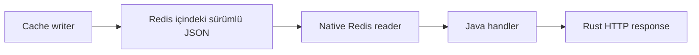

# rest-sample-cache-reader

## Hazırlanan Düzeltme 0.8.1

Bu kaynak ağacı REST/platform 4.8.1 ve cache 0.9.1 kullanır. ARM manifesti
düzeltmesini içerir. İş kodu ve native ABI'ler değişmez. Yayım onayı bekleniyor;
yayımlanmış sample sürümü hâlâ 0.8.0'dır.
[Düzeltme notları](docs/RELEASE_NOTES_v0.8.1.tr.md).

[English](README.md) | [Türkçe](README.tr.md)

## 0.8.0 İle Başlayın

Gerçek projection okuma akışı, isteğe bağlı sürümlü L1 ve sahipliği izlenen JSON yanıtlarını destekler. Ayrı profiller public edge, native view, JWT, izleme, ortak tampon ve dış HTTP çağrısını gösterir. Varsayılan uygulama yalnız Redis'ten okur.

[Kullanım rehberi](docs/functional-operations.tr.md) · [Sürüm notları](docs/RELEASE_NOTES_v0.8.0.tr.md)


Özellik, çalıştırma ve hata eşleştirmesi: [Kullanım örnekleri](docs/functional-operations.tr.md).

Kaynak kod örneği: [Rust'a ait binary buffer'ı okuyup JSON üretme](NATIVE_VIEW.tr.md).
Ayrı `native-view` derlemesi, varsayılan Redis okuyucusunu değiştirmez.

Kaynak kod örneği: [Üretilmiş HTTP istemcisi, devre kesici ve native HS256](OUTBOUND.tr.md).
Ayrı `outbound` derlemesi Redis'e bağlanmaz.

Kaynak kod örneği: [Açık anahtarla JWT ve sınırlı token önbelleği](JWT_SECURITY.tr.md).
`jwt-security` derlemesi yalnız REST/security kullanır. Varsayılan Redis reader değişmez.

Kaynak kod örneği: [Bir isteği HTTP servisleri arasında izleyin](TRACE_PROPAGATION.tr.md).
Ayrı `trace-propagation` derlemesi W3C parent ID ve retry başlık korumasını gösterir.

İsteğe bağlı örnek: [Ham Redis JSON verisini sınırlı shared slab ile döndürme](SHARED_SLAB.tr.md).
Ayrı `shared-slab` derlemesinde handler Java'da kalır. OpenJ9 JNI slab kullanır; uygun HotSpot için FFM seçilebilir.
Sürümlü projection okuması ve varsayılan okuyucu değişmez.

Redis'te hazır duran JSON snapshot'larını REST API ile sunan küçük bir uygulamadır.

- HTTP trafiğini `rust-java-rest` karşılar.
- Redis I/O işlemlerini `java-rust-cache` üzerinden Rust yapar.
- Handler ve iş akışı Java'da kalır.
- Bu uygulama PostgreSQL'e bağlanmaz.
- Bu uygulama Redis'e veri yazmaz.

Kullanılan sürümler: `rust-java-rest:4.8.0`, `java-rust-cache:0.9.0`, `rust-sample-model:0.5.0`.

## Önce Bu Bölümü Okuyun

Redis içinde sürümlü UTF-8 JSON snapshot'ları zaten varsa ve REST uygulaması yalnız okuyacaksa bu
sample doğru başlangıçtır. Read-through database erişimi, cache yazma veya elle Redis key birleştirme
için bu projeden başlamayın.

| Hedef | Bölüm |
| --- | --- |
| Lokal çalıştırmak | [Hızlı Başlangıç](#hızlı-başlangıç) |
| Standalone, Sentinel veya Cluster seçmek | [Redis Modunu Seçin](#redis-modunu-seçin) |
| Yalnız uygulama ayarını değiştirmek | [Konfigürasyon](#konfigürasyon) |
| Sık okunan JSON'u bu uygulamada tekrar kullanmak | [İsteğe bağlı L1 okuma](#isteğe-bağlı-l1-okuma) |
| Herkese açık ürün kataloğunu Rust edge ile sunmak | [Public katalog kaynak kod örneği](docs/public-edge.tr.md) |
| Glowroot telemetrisini açmak | [Glowroot Agent ile Telemetri](#glowroot-agent-ile-telemetri) |
| Hata çözmek | [Sık Karşılaşılan Sorunlar](#sık-karşılaşılan-sorunlar) |

POM, `rust-java-platform-parent` ve tek bir `rust-java-starter-cache-reader` bağımlılığı kullanır.
Parent; REST, cache, DSL-JSON, codegen ve build gate sürümlerini birlikte yönetir. Kod üreteçleri
yalnız derleyici yolunda kalır. Runtime sınıfı olarak pakete girmez.

## Güncel Kaynak Ayarları

Bu güncelleme, platformu REST `4.8.0` ve isteğe bağlı agent `0.7.1` ile eşler.
Seçtiğiniz bağımlılığın native dosyasını kullanın. Eski SO/DLL dosyalarını karıştırmayın.
İş kodu, URL'ler ve ayar anahtarları değişmez. Telemetri varsayılan olarak kapalıdır.
HTTP micro bellek testi, veritabanı işinde veya daha ayrıntılı profilde aynı maliyeti garanti etmez.

`0.8.0` sürümü platform parent `4.8.0` kullanır. Uygulamayı hizalanmış bağımlılıklarla
yeniden derleyin. [Sürüm notlarını](docs/RELEASE_NOTES_v0.8.0.tr.md) okuyun. Runtime ayarları ve adresler değişmez.

- `@EnableRustCache` tek bir managed native cache lifecycle oluşturur.
- `@GenerateProjectionReader`, customer read implementasyonunu build sırasında üretir.
- Uygulama `@ReactorApplication` ile başlar. Elle yazılmış reader module kaldırıldı.
- Redis key'leri, projection namespace'leri, REST adresleri ve read-only davranış değişmedi.
- REST, ABI `29/7/6/6` hattını kullanır. Cache paketi kendi Redis ABI `6` sözleşmesini doğrular.

İsteğe bağlı Glowroot mikro telemetri katmanı, uyumlu REST `4.8.0` çalışma katmanıyla kullanılabilir.
Varsayılan olarak kapalıdır. Yalnız bu servis mevcut Glowroot Central kurulumuna sınırlandırılmış HTTP
ve native Redis süreleri gönderecekse açın. Handler veya projection kodu değişmez.

## Deklaratif Akış

| Sizin yazdığınız kod | Framework'ün ürettiği veya yönettiği alan | Bu process'te hiç açılmayan alan |
| --- | --- | --- |
| Projection okuma kontratı | Bağlanmış projection reader | Redis write pool |
| REST handler | Constructor bağlantısı ve route invoker | PostgreSQL connection pool |
| Namespace property'leri | Cache lifecycle ve key planı | Scheduler ve distributed lock |
| Readiness dependency | Bounded readiness kontrolü | Hazır JSON için tekrar object graph |

Application annotation, projection kontratı ve handler kodunu alın. Business kodunda elle
`RustCache` oluşturmayın ve Redis key birleştirmeyin.

## Buradan Başlayın

Başka bir uygulama Redis read modelini hazırlıyorsa bu sample'ı kullanın.

Snapshot, Redis'e belirli bir sürümle yazılmış hazır veri setidir.

```text
PostgreSQL -> cache writer -> Redis -> bu reader -> HTTP istemcisi
```



Snapshot üretmeniz gerekiyorsa önce
[`rest-sample-cache-writer`](https://github.com/esasmer-dou/rest-sample-cache-writer) projesini çalıştırın.

## Hızlı Başlangıç

### 1. Örnek veriyi yayınlayın

Writer sample'ı bir kez çalıştırın. Writer, PostgreSQL verisini okuyup Redis snapshot'larını oluşturur.

### 2. Reader'ı başlatın

Bu repo dizininde çalıştırın:

```powershell
$env:GITHUB_PACKAGES_TOKEN="READ_PACKAGES_YETKILI_TOKEN"

mvn -q `
  "-Dserver.port=18080" `
  "-Dreactor.cache.redis.host=127.0.0.1" `
  "-Dreactor.cache.redis.port=16379" `
  clean compile exec:java
```

Başlangıç sınıfı `pom.xml` içinde hazırdır.

### 3. API'yi çağırın

```powershell
curl.exe http://127.0.0.1:18080/app/health
curl.exe http://127.0.0.1:18080/app/readiness
curl.exe http://127.0.0.1:18080/api/v1/cache/customers/1
curl.exe "http://127.0.0.1:18080/api/v1/cache/customers/by-customer-no?customerNo=CUST-1002"
curl.exe http://127.0.0.1:18080/api/v1/cache/customers/segments/pilot
curl.exe http://127.0.0.1:18080/api/v1/cache/customers/statuses/active
curl.exe http://127.0.0.1:18080/api/v1/cache/customers/campaigns/retention/candidates
curl.exe http://127.0.0.1:18080/api/v1/cache/customers/meta
```

`/app/health` yalnızca uygulamayı kontrol eder. `/app/readiness`, Redis snapshot'ının hazır olup olmadığını da kontrol eder.

## Temel Endpoint'ler

| Endpoint | Dönen veri |
|---|---|
| `GET /api/v1/cache/customers/{id}` | Tek müşteri snapshot'ı |
| `GET /api/v1/cache/customers/by-customer-no?customerNo=...` | Müşteri numarasına göre tek müşteri |
| `GET /api/v1/cache/customers/segments/{segment}` | Bir segmentteki müşteriler |
| `GET /api/v1/cache/customers/statuses/{status}` | Bir durumdaki müşteriler |
| `GET /api/v1/cache/customers/campaigns/{campaign}/candidates` | Kampanya adayları |
| `GET /api/v1/cache/customers/meta` | Snapshot bilgisi |
| `GET /api/v1/cache/customers/cache-metrics` | JSON cache metrikleri |

## Redis Modunu Seçin

| Ortam | Ayar |
|---|---|
| Lokal Redis | `reactor.cache.redis.topology=standalone` |
| Redis Sentinel | `reactor.cache.redis.topology=sentinel`, Sentinel node'ları ve master adı |
| Redis Cluster | `reactor.cache.redis.topology=cluster` ve cluster node'ları |

Reader bilinçli olarak yalnızca okuma yapar:

```properties
reactor.cache.redis.access-mode=read-only
```

Bu uygulama Redis'e veri yazmayacaksa write kapasitesini açmayın.

## Konfigürasyon

Uygulama ayarları şu sırayla okur:

1. `src/main/resources/rust-spring.properties`
2. `reactor.config.file` veya `REACTOR_CONFIG_FILE` ile verilen dosyalar
3. JVM `-D...` değerleri ve desteklenen environment variable'lar

Önce lokal varsayılanlarla başlayın:

```properties
server.port=8080
reactor.runtime.profile=micro-rest
sample.cache.customer.namespace=crm.customer
reactor.cache.redis.host=127.0.0.1
reactor.cache.redis.port=6379
```

Deployment sırasında production ayarlarını ekleyin:

```powershell
java "-Dreactor.config.file=src/main/resources/config/production.properties" ...
```

İleri seviye ayarları yalnızca gecikme, reddedilen istek ve process memory (RSS) ölçümü yaptıktan sonra kullanın:

```powershell
java "-Dreactor.config.file=src/main/resources/config/production.properties;src/main/resources/config/advanced-tuning.properties" ...
```

| Dosya | Amacı |
|---|---|
| `rust-spring.properties` | Küçük lokal varsayılanlar |
| `config/production.properties` | Güvenli production limitleri ve timeout'lar |
| `config/advanced-tuning.properties` | Route limitleri, native trim ve namespace override'ları |
| `config/l1.properties` | Detail/segment için isteğe bağlı, sınırlı L1 alanı; temel ayarlarda kapalı |

Reader ve writer namespace değerleri aynı olmalıdır. Writer `crm.customer.campaign` namespace'ine yazıyorsa reader da aynı değeri okumalıdır.

## İsteğe Bağlı L1 Okuma

Sample `0.8.0`, yayımlanmış cache `0.9.0` L1 okuyucusunu REST/platform `4.8.0` ile kullanır.
Hizalanmış paketleri ve pakete ait native dosyayı kullanın. Kardeş kütüphaneleri
kaynaktan derlemek ön koşul değildir. L1 isteğe bağlı kalır.

Aynı müşteri veya segment sık isteniyorsa L1 kullanabilirsiniz. Sürümlü verinin kaynağı
yine Redis'tir. L1'de bulunan JSON için Redis'ten tekrar veri alınmaz. Java handler,
doğrulama ve yanıt kodları değişmez. İstek Java'yı atlayıp Rust'tan doğrudan dönmez.

Sample'ın okuma kontratı, derleme sırasında L1 seçimine izin verir:

```java
@GenerateProjectionReader(
    rootPrefix = "sample.cache.customer",
    generatedName = "CustomerCacheReader",
    restBean = true,
    allowL1 = true)
public interface CustomerCacheService {
    @ProjectionIdRead(projection = "detail")
    CacheReadValue customerValue(long id);
}
```

Gerçek ID ve segment handler'ları `CacheReadValue` kullanır: varsayılan yardımcı
`CacheResponses.valueJson(...)`, `sample.errors.common-contract=true` seçilirse `CacheResponses.valueProblem(...)` olur.
L1 kapalıysa Redis'ten gelen byte dizisi doğrudan raw yanıta aktarılır. Snapshot
sarmalayıcısı oluşturulmaz. L1 açıksa value, sahipliği kontrollü snapshot taşır.
Yanıt yazıcısı, yazma veya iptal sonrasında pin'i bırakır. Yardımcı metoda devrettikten
sonra handler'da kapatmayın. Mevcut result ve snapshot API'leri de korunur.

Normal başlangıçta yalnız Redis okuyucusu kullanılır. Detail ve segment için L1'i açın:

```powershell
mvn -q `
  "-Dreactor.config.file=src/main/resources/config/l1.properties" `
  "-Dreactor.cache.redis.host=127.0.0.1" `
  "-Dreactor.cache.redis.port=16379" `
  compile exec:java
```

| Dosyadaki ayar | Ne işe yarar? |
| --- | --- |
| `sample.cache.customer.detail.l1.max-entries=16` | Sabit alanda en fazla 16 müşteri detayı tutar. |
| `sample.cache.customer.detail.l1.max-entry-bytes=2048` | En fazla 2 KiB olan detay verisini L1'de tutar. |
| `sample.cache.customer.segment.l1.max-entries=4` | En fazla dört segment verisi tutar. |
| `sample.cache.customer.segment.l1.max-entry-bytes=32768` | En fazla 32 KiB olan segment verisini L1'de tutar. |
| `sample.cache.customer.detail.l1.max-bytes=65536` | Detay alanını ve tahmini yönetim belleğini sınırlar. |
| `sample.cache.customer.segment.l1.max-bytes=163840` | Segment alanını ve tahmini yönetim belleğini sınırlar. |
| `sample.cache.customer.detail.l1.max-age-ms=1000` | Bir saniyesini dolduran detay verisini yeniden alır. Segment için de 1000 ms kullanılır. |
| `sample.cache.customer.segment.l1.max-age-ms=1000` | Bir saniyesini dolduran segment verisini yeniden alır. |
| `sample.cache.customer.detail.l1.max-key-chars=256` | Saklanan detay/index anahtarını 256 UTF-16 birimiyle sınırlar. |
| `sample.cache.customer.segment.l1.max-key-chars=256` | Segment anahtarına aynı sınırı uygular. |
| `sample.cache.customer.l1.max-entries=0` | Kendi etkin ayarı olmayan projection'ları kapalı bırakır. JVM veya genel ortam ayarıyla 0 verilirse hepsini kapatır. |
| `sample.cache.customer.version-cache-ms=1000` | Sıralı okumada snapshot sürümünü en fazla saniyede bir kontrol eder. Süresi dolan eşzamanlı okumalar ayrı kontrol yapabilir. |

İki sabit veri alanının toplamı process/replica başına yaklaşık 0,17 MiB'dir. Bu değer uygulamanın toplam RSS'i
değildir. Status, campaign ve meta doğrudan Redis'ten okunur. Boyut sınırını aşan veri
L1'e alınmaz; normal okuma devam eder.

Bu sınırlar HTTP yanıtını küçültmez; yalnız L1 alanını belirler. Müşteri JSON'unuz
sık sık 2 KiB sınırını aşıyorsa `sample.cache.customer.detail.l1.max-entry-bytes` ve
`sample.cache.customer.detail.l1.max-bytes` değerlerini birlikte artırın.
Örneğin `8192` ve `196608`, her biri en fazla 8 KiB olan 16 kayıt için yeterlidir.
Daha büyük segment listelerinde `sample.cache.customer.segment.l1.max-entry-bytes=131072`
ve `sample.cache.customer.segment.l1.max-bytes=655360` kullanabilirsiniz. Bu seçim
daha fazla sabit bellek ayırır. Büyük yanıtlar nadirse küçük reçeteyi koruyun;
bu yanıtlar yine Redis üzerinden döner.

L1 hit'inde `CacheReadValue` yanıtı, sahipliği izlenen native handle'ı REST yanıt
yazıcısına devreder. Veri, Java payload dizisi oluşturulmadan sabit alandan native
HTTP buffer'a kopyalanır. Java handler yine çalışır; bu akış ağda sıfır kopya değildir.
Büyük native frame, gönderim bitene kadar Rust tarafında tutulur. Havuza dönmesi,
bu alanın hemen işletim sistemine bırakılacağı anlamına gelmez.
Mevcut `CacheReadResult` metotları bağımsız byte dizisi döndürmeye devam eder.

L1 kapalıyken mevcut value route'u Redis `byte[]` sonucunu raw body olarak döndürür;
snapshot sarmalayıcısı oluşturmaz. Açık `customerSnapshot(...)` / `segmentSnapshot(...)`
çağrıları ayrı sahiplik API'sidir; Redis-only modda da küçük sahiplik nesneleri oluşturur.
L1, daha az Redis çağrısı için ek yerel bellek kullanır. RSS'in mutlaka düşmesini
sağlamaz. En düşük bellek önceliğinde normal Redis-only ayarını koruyun.

| İhtiyacınız | Seçim |
| --- | --- |
| Hazır JSON'u mevcut HTTP route'larından sunmak | `CacheReadValue` ve `valueJson(...)` / `valueProblem(...)` |
| Özel kodda snapshot sahipliğini açıkça yönetmek | `CacheReadSnapshot` ve `CacheResponses.ownedJson(...)` |
| Java'da JSON byte'larını incelemek veya değiştirmek | Mevcut `CacheReadResult` metotları |

Kendi controller'ınız için alternatif açık sahiplik örneği (mevcut handler implementasyonu değildir):

```java
@GetMapping("/{id}")
public ResponseEntity<?> customer(@PathVariable("id") long id) {
    return CacheResponses.ownedJson(
        customerCache.customerSnapshot(id),
        "customer_not_cached", "customer_cache_not_ready");
}
```

Yardımcı metot, snapshot'ın sahipliğini alır. Yazım bittiğinde, hata oluştuğunda veya
bekleyen native buffer tekrarı iptal edildiğinde kaynak bırakılır. Buffer küçükse aynı
snapshot korunur; Java handler yeniden çağrılmaz. Aynı snapshot'ı başka HTTP isteğinde
kullanmayın. Snapshot'ı alıp yanıt olarak döndürmekten vazgeçerseniz kendiniz kapatın.
`ownedJson(...)` ile döndürdüğünüz snapshot'ı controller içinde try-with-resources
ile kapatmayın. Bu, framework yanıtı yazmadan kaynağı kapatır.
Adres, UTF-8 içerik ve hata sözleşmesi değişmez. Uyumlu REST çalışma katmanı gerekir.
Buffer tekrarını desteklemeyen eski native çalışma katmanında büyük owned yanıt açık
hata verir; iş mantığı sessizce yeniden çalıştırılmaz.

L1 yaşı, Redis TTL'i değildir. Writer yeni snapshot yayımladığında değişiklik, seçilen
sürüm kontrol aralığından sonra görülür. Her okumada sürüm kontrolü gerekiyorsa
`version-cache-ms=0` kullanın. Bu ayarda veri L1'den gelebilir; ancak her çağrıda Redis'ten
sürüm okunur. Kaynak hatasında kendiliğinden eski veri döndürülmez. Seçtiğiniz sürüm
kontrol süresini tolere edemeyen veriler için bu ayarı kullanmayın.
L1 yaşını snapshot TTL'inden kısa tutun. L1, her hit'te Redis anahtarının süresini
kontrol etmez. Silinme veya süre dolması her okumaya hemen yansımalıysa ilgili
projection'ı yalnız Redis'ten okuyun.

Dosyayı değiştirmeden L1'i kapatmak için `-Dsample.cache.customer.l1.max-entries=0`
ekleyin. Ortam değişkeni karşılığı `SAMPLE_CACHE_CUSTOMER_L1_MAX_ENTRIES=0` olur.
L1'in kullanıldığını kontrol edin:

```powershell
curl.exe http://127.0.0.1:8080/api/v1/cache/customers/cache-metrics
```

Yeni `l1` alanında etkin projection sayısı (`enabled_projections`), bulunan okumalar
(`hits`), bulunamayan okumalar (`misses`), sabit alanın boyutu (`slab_bytes`) ve açık
ödünç okuma sayısı (`active_borrows`) görünür. İstekler tamamlandığında `active_borrows`
normalde 0 olmalıdır.
Üretilen okuyucu kapanırken L1 alanının sahipliği bırakılır. Redis istemcisi ayrıca kapatılır.
Sürüm, ödünç okuma ve bellek sınırları için [L1 sözleşmesine](https://github.com/esasmer-dou/java-rust-cache/blob/master/docs/versioned-l1.tr.md) bakın.

## Glowroot Agent ile Telemetri

Bu uygulama Rust-Java REST üzerinde çalışır. Ayrı bir Spring starter veya agent çalışma katmanı
gerekmez. Telemetri varsayılan olarak kapalıdır. Açıldığında HTTP route ve native Redis read süreleri
aynı Rust çalışma katmanında toplanır. Handler ve projection kodu değişmez.

Bu sample, Glowroot ABI `6` taşıyan production platform `4.8.0` sürümünü kullanır. İsteğe bağlı
`java-rust-glowroot-agent:0.7.1` JAR'ı yalnız `-javaagent` biçimi gerekiyorsa eklenir. REST içine
gömülü telemetri runtime'ı için ayrı agent dependency gerekmez:

```xml
<parent>
  <groupId>com.reactor</groupId>
  <artifactId>rust-java-platform-parent</artifactId>
  <version>4.8.0</version>
  <relativePath/>
</parent>
```

Lokal kullanım için `rust-spring.properties` dosyasına şu değerleri ekleyin:

```properties
reactor.glowroot.enabled=true
reactor.glowroot.profile=micro
reactor.glowroot.collector.address=http://127.0.0.1:8181
reactor.glowroot.agent.id=cache-reader-local
reactor.glowroot.application.name=rest-sample-cache-reader
reactor.glowroot.http.sample-rate=256
reactor.glowroot.trace.capacity=0
```

`reactor.native.capabilities` değerini ayrıca tanımlıyorsanız gerekli yüzeyleri açıkça ekleyin:

```properties
reactor.native.capabilities=http,redis,glowroot
```

Kubernetes'te aynı ayarları environment variable olarak verin:

```yaml
env:
  - name: REACTOR_GLOWROOT_ENABLED
    value: "true"
  - name: REACTOR_GLOWROOT_PROFILE
    value: "micro"
  - name: REACTOR_GLOWROOT_COLLECTOR_ADDRESS
    value: "http://glowroot-collector.observability.svc.cluster.local:8181"
  - name: REACTOR_GLOWROOT_AGENT_ID
    valueFrom:
      fieldRef:
        fieldPath: metadata.name
  - name: REACTOR_GLOWROOT_APPLICATION_NAME
    value: "rest-sample-cache-reader"
```

Uygulama başladıktan sonra agent durumunu kontrol edin:

```powershell
curl.exe http://127.0.0.1:18080/diagnostics/glowroot
```

| İhtiyaç | Profil | Kullanım |
|---|---|---|
| Normal production trafiği | `micro` | HTTP, Redis, RSS, thread ve exporter sağlığı |
| Heap veya GC araştırması | `jvm` | Tek podda geçici olarak açın |
| SQL ölçümü | Kullanmayın | Reader PostgreSQL'e bağlanmaz |
| Hata ve JVM incelemesi | `full` | Kısa inceleme süresi için kullanın |
| Thread veya heap çıktısı | `diagnostic` | Yalnız yetkili operasyon sırasında açın |

`micro` production gate'i en fazla bir exporter thread'i ve `3 MiB` yerleşik bellek sınırıyla
doğrulanmıştır. Collector erişilemezse reader trafiği devam eder. Gönderilemeyen telemetri sınırlı
drop sayaçlarına yansır. `/diagnostics/glowroot` endpoint'ini public ingress'e açmayın.

Agent'i kullanmayacaksanız şu varsayılanı koruyun:

```properties
reactor.glowroot.enabled=false
```

Ayrıntılı profil ve çalışma sırasında geçiş örnekleri için
[`java-rust-glowroot-agent`](https://github.com/esasmer-dou/java-rust-glowroot-agent/blob/master/README.tr.md)
dokümanını kullanın.

## Kod Haritası

| Dosya | Görevi |
|---|---|
| `RestSampleCacheReaderApplication.java` | Generated REST ve Rust cache lifecycle'ını açar |
| `CacheReaderConfiguration.java` | Yalnız readiness endpoint bean'ini tanımlar |
| `CustomerCacheService.java` | Projection okumalarını tanımlar; implementasyon üretilir |
| `CustomerCacheHandler.java` | REST endpoint'lerini açar |
| `rust-spring.properties` | Lokal ayarları taşır |

ID ve segment route'ları `CacheReadValue`, diğer cache route'ları `CacheReadResult`
ve raw JSON yanıtı kullanır. Büyük bir Java nesne ağacı yeniden kurulmaz. Redis-only
byte dizisi ile native yanıt sahipliğinin farkı için L1 bölümüne bakın.

Uygulama `RustCache`, bound projection veya handler nesnelerini elle kurmaz. `@EnableRustCache`, native
cache başlangıç ve kapanışını yönetir. `@GenerateProjectionReader`, projection ve index adlarını
başlangıçta bir kez bağlar. `@ReactorApplication` ve constructor injection, generated reader'ı REST
handler'a bağlar. Bu yardımcılar derleme sırasında üretilir. Request sırasında reflection eklemez.

## Maven Package Erişimi

GitHub Packages için `read:packages` yetkili token gerekir. Token'ın private ortak sample repolarına da erişimi olmalıdır.

Şu server kimliklerini `~/.m2/settings.xml` dosyasına ekleyin:

```xml
<servers>
  <server>
    <id>github-rust-java-rest</id>
    <username>GITHUB_KULLANICI_ADI</username>
    <password>${env.GITHUB_PACKAGES_TOKEN}</password>
  </server>
  <server>
    <id>github</id>
    <username>GITHUB_KULLANICI_ADI</username>
    <password>${env.GITHUB_PACKAGES_TOKEN}</password>
  </server>
  <server>
    <id>github-rust-sample-model</id>
    <username>GITHUB_KULLANICI_ADI</username>
    <password>${env.GITHUB_PACKAGES_TOKEN}</password>
  </server>
</servers>
```

Maven `401` dönerse token'ı, repo erişimini, environment variable'ı ve server kimliklerini kontrol edin.

## Sık Karşılaşılan Sorunlar

| Belirti | Kontrol edin |
|---|---|
| Maven build sırasında `401 Unauthorized` | GitHub token ve `settings.xml` server kimlikleri |
| Readiness `DOWN` | Writer çalıştı mı ve `meta` snapshot'ı var mı? |
| Endpoint cache miss dönüyor | Reader ve writer veri grubu namespace değerleri |
| Hazır olmayan cache `404` veya `503` dönüyor | Varsayılan eski sözleşme `404`, isteğe bağlı ortak hata sözleşmesi `503` kullanır. [Hata tablosuna](docs/functional-operations.tr.md#http-hata-tablosu) bakın |
| Redis timeout oluşuyor | Redis adresi, bağlantı biçimi ve timeout değerleri |
| Container native kütüphaneyi yükleyemiyor | Yazılabilir `reactor.cache.native.extract-dir` dizini |
| Glowroot verisi görünmüyor | `enabled`, collector adresi, agent id ve `/diagnostics/glowroot` çıktısı |

## Production Kontrol Listesi

- `reactor.cache.redis.access-mode=read-only` değerini koruyun.
- Reader ve writer namespace adlarını aynı tutun.
- Gerekli `meta` snapshot veya Redis erişilemiyorsa readiness `DOWN` olmalıdır.
- Redis connection, max-in-flight read, response byte, HTTP connection ve route admission değerlerini sınırlayın.
- Tek Redis node kabul edilen availability sınırı değilse Sentinel veya Cluster kullanın.
- Karışık endpoint ile c64/c256 yük, p99, `503`, RSS, Redis restart/failover ve yük sonrası idle testi yapın.
- Hazır JSON'u yalnız tekrar serialize etmek için DTO'ya çevirmeyin.
- Agent açıksa `micro` ile başlayın; geniş profilleri yalnız kısa ve yetkili inceleme için açın.

## Kısa Sözlük

| Terim | Basit anlamı |
| --- | --- |
| Snapshot | Hazırlanmış okuma modelinin tutarlı biçimde yayınlanmış bir sürümü |
| Namespace | Bir projection ailesini diğerinden ayıran sabit key prefix'i |
| Projection | Bir endpoint veya sorgu ailesi için hazırlanmış cache biçimi |
| Read-only mode | Bu process içinde native Redis write kaynaklarının oluşturulmaması |
| Readiness | Uygulamanın gerekli bağımlılıklarıyla gerçek trafik sunabilme durumu |
| Telemetri profili | Agent'in o anda topladığı veri ve ayırdığı sınırlı kaynak yüzeyi |

## Ayrıntılı Bilgi

- [Türkçe kullanıcı rehberi](docs/USER_GUIDE.tr.md)
- [Türkçe PDF rehberi](docs/rest-sample-cache-reader-user-guide.tr.pdf) (önceki kopya; bu düzeltmeler için Markdown'ı kullanın)
- [Production ayarları](src/main/resources/config/production.properties)
- [Advanced tuning ayarları](src/main/resources/config/advanced-tuning.properties)
- [v0.8.0 sürüm notları](docs/RELEASE_NOTES_v0.8.0.tr.md)
- [Henüz yayımlanmamış belge düzeltmeleri](docs/RELEASE_NOTES_UNRELEASED.tr.md)
